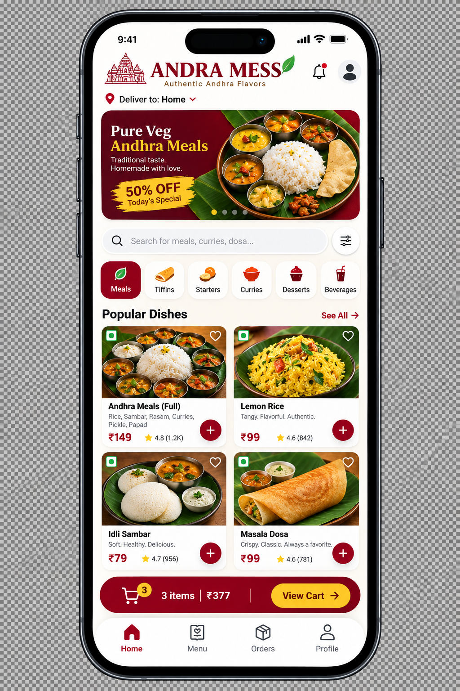

# 🍛 ANDRA MESS

### Mobile-first Andhra food ordering demo

A phone-sized food ordering experience built with Next.js. Browse an
Andhra-inspired menu, add dishes to a cart, enter delivery details, and
complete a guest checkout using Razorpay **test mode**.

<p align="center">
  
</p>

> **Portfolio demo:** Menu items and promotions are sample content. Payment
> requires Razorpay test credentials; this repository is not configured as a
> live restaurant service.

## ✨ Features

- 🍽️ Browse meals, tiffins, curries, rice, and breads with food photography
- 🛒 Add dishes to the cart and adjust quantities
- 📱 Use a mobile-first layout with a phone-width storefront on desktop
- 🧾 Enter guest name, phone, address, and order notes at checkout
- 💳 Create Razorpay test orders and verify payment signatures on the server
- 📦 Store orders and order items in Supabase after setup
- 🎨 Explore animated banners and menu cards

## 🧰 Tech stack

| Area | Tools |
| --- | --- |
| App | Next.js 16, React 19, TypeScript |
| UI | Tailwind CSS 4, Framer Motion, Lucide React |
| State | Zustand, TanStack Query |
| Data | Supabase |
| Payments | Razorpay test mode |

## 🚀 Run locally

**Prerequisite:** Node.js 20.9 or later.

1. Install dependencies:

   ```bash
   npm install
   ```

2. Create a Supabase project. Run
   [`supabase/migrations/0001_orders_and_order_items.sql`](supabase/migrations/0001_orders_and_order_items.sql)
   in its SQL editor.

3. Copy `.env.local.example` to `.env.local` and fill in your own
   Supabase credentials and **Razorpay test** keys:

   ```bash
   cp .env.local.example .env.local
   ```

   The Supabase service-role key and Razorpay secret must stay on the
   server. Never add `NEXT_PUBLIC_` to those secret variables.

4. Start the development server:

   ```bash
   npm run dev
   ```

5. Open [http://localhost:3000](http://localhost:3000).

The menu can be explored without payment credentials. Completing checkout
requires the Supabase setup and Razorpay test keys.

## 🧭 Order flow

```text
Browse menu → Add to cart → Enter delivery details
→ Razorpay test checkout → Verify signature → Order confirmation
```

The server calculates prices from the menu data instead of trusting totals
sent by the browser. The payment verification route checks Razorpay's
signature before marking an order paid in Supabase.

## 📂 Project structure

| Path | Purpose |
| --- | --- |
| `app/(customer)/` | Menu, cart, checkout, and confirmation pages |
| `app/api/` | Order creation and payment verification routes |
| `components/ui/` | Shared storefront components |
| `lib/data/` | Sample menu and promotional banners |
| `store/` | Cart state |
| `supabase/migrations/` | Order tables and database policies |
| `public/images/` | Food and banner imagery |

## 🔒 Configuration notes

`.env.local` is ignored by Git. The committed
`.env.local.example` contains placeholders only. Use test credentials
while evaluating this portfolio project.
